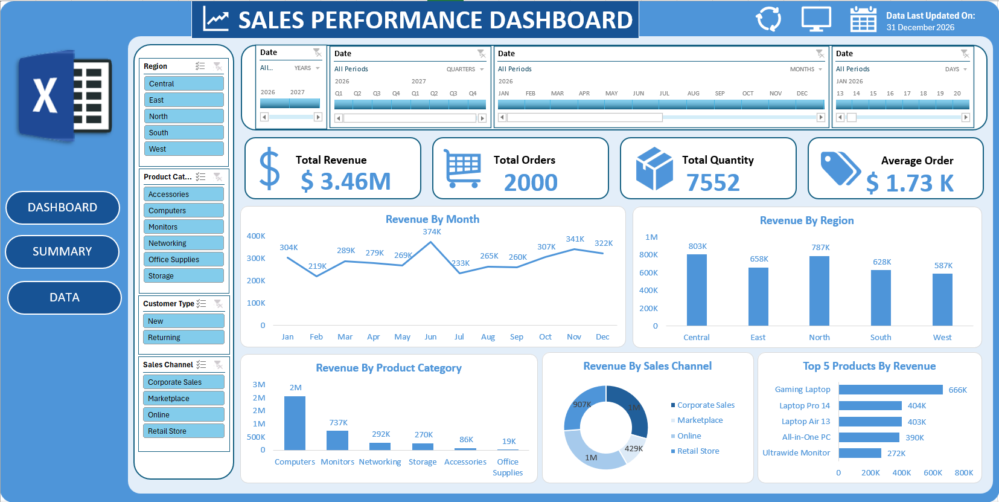

# Excel Sales Dashboard

## Project Overview

This project involves building an interactive Sales Dashboard in Microsoft Excel to explore sales performance and present business data in a clear, visual format.

The dashboard uses PivotTables, KPI cards, charts, Slicers, and Timeline filters to help users interact with the data and examine sales trends across different categories and time periods.

## Objectives

- Summarize key sales performance indicators.
- Explore sales data through interactive visualizations.
- Analyze trends across different time periods.
- Make sales information easier to interpret using a dashboard layout.

## Tools and Features

- **Microsoft Excel** — Dashboard development and data analysis.
- **PivotTables** — Summarizing and aggregating sales data.
- **KPI Cards** — Displaying selected key performance indicators.
- **Charts** — Visualizing sales data and trends.
- **Slicers** — Filtering dashboard data interactively.
- **Timeline Filters** — Exploring data across selected time periods.

## Dashboard Preview

## Interactivity

The dashboard includes Slicers and Timeline filters to allow users to filter the displayed information. PivotTables and charts support the exploration and presentation of sales data.

## Dataset

This project uses dummy sales data for learning and portfolio demonstration purposes. The dataset was obtained from an online source and was used to practice data summarization, dashboard creation, and interactive data visualization in Microsoft Excel.

The data does not represent verified real-world business transactions, so the dashboard is intended to demonstrate Excel skills rather than draw conclusions about an actual company's sales performance.

**Dataset source:** [https://drive.google.com/uc?export=download&id=1xGf_x6awGWCArPPnaD1p2lt-CFG6f7mI]

## Key Learnings

- Building an interactive dashboard in Excel.
- Summarizing data using PivotTables.
- Presenting key metrics using KPI cards.
- Using charts to communicate patterns in data.
- Applying Slicers and Timeline filters for interactive exploration.

## How to Explore the Project

1. Download `Sales_data_Dashboard.xlsm` from this repository.
2. Open the workbook in Microsoft Excel.
3. Navigate to the dashboard worksheet.
4. Use the available Slicers and Timeline filters to explore the data.

For the best experience, use a desktop version of Excel that supports the workbook's interactive features.

## Author

**Aman Alam**

Aspiring Data Analyst | SQL | Excel | Python
